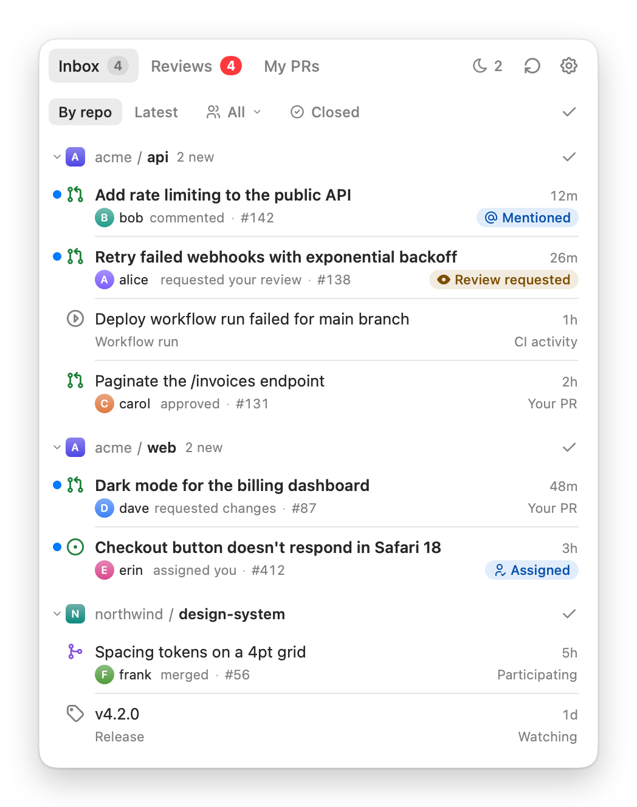
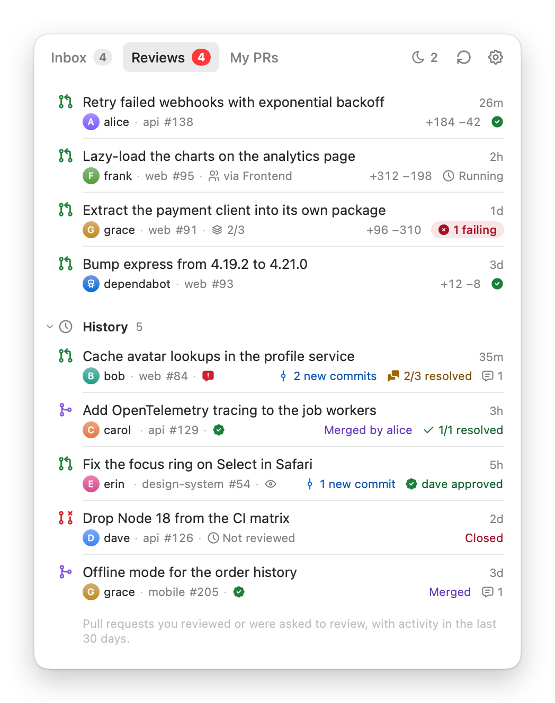
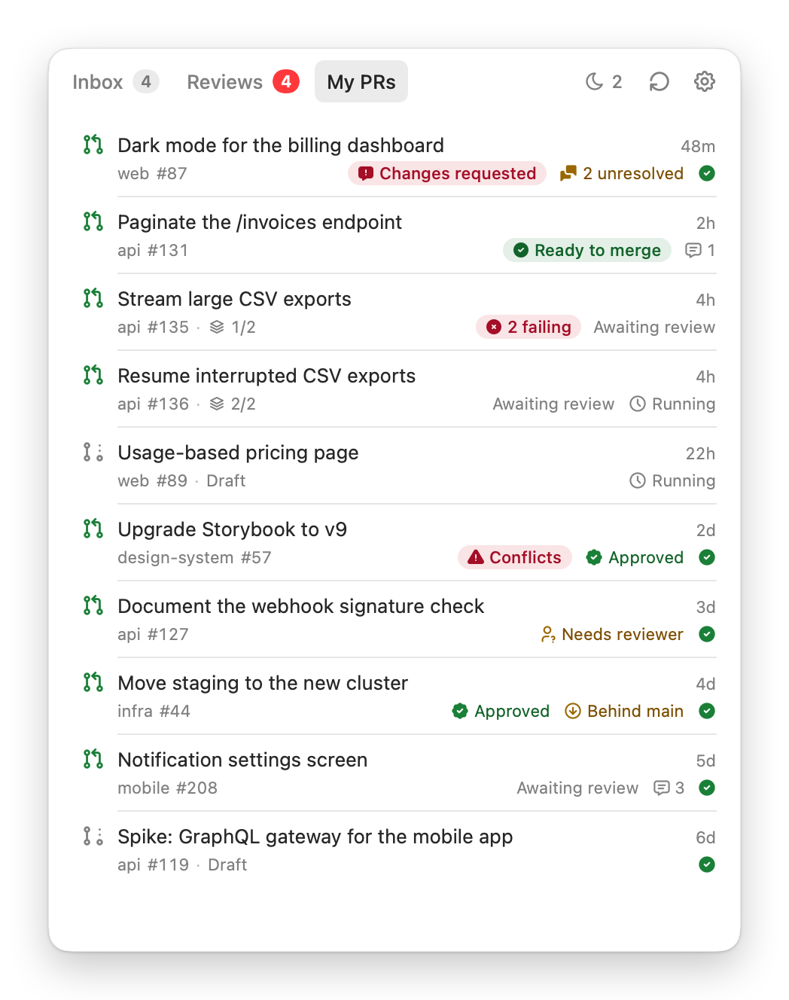
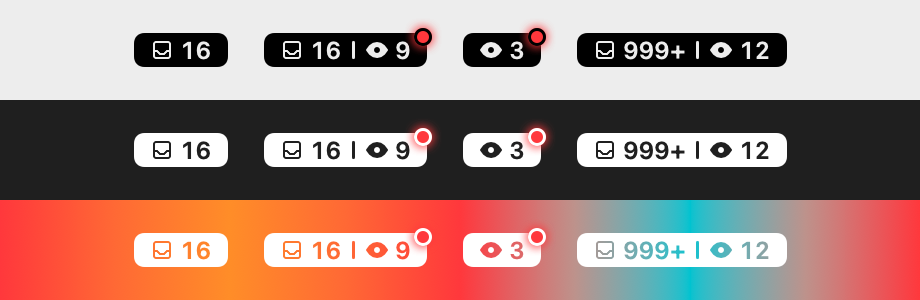

<div align="center">

# DevInbox

**Your GitHub notifications, review requests and pull requests in the macOS menu bar.**

<picture>
  <source media="(prefers-color-scheme: dark)" srcset="docs/inbox-dark.png">
  
</picture>

</div>

DevInbox is a menu bar app for macOS 26. Click its pill in the menu bar, or press `⇧⌘K` in any app, and a panel opens with three tabs. DevInbox signs in with your [GitHub CLI](https://cli.github.com) login and talks only to GitHub. It has no server, analytics or telemetry.

## Features

- The pill shows two counts, unread notifications and waiting reviews. A red dot appears when someone requests your review.
- The Inbox tab works like a to-do list. A notification stays until you check it off, and each row says who did what and why it reached you.
- The Reviews tab lists the pull requests waiting for your review. Its history shows what happened to the ones you reviewed.
- The My PRs tab shows what each of your pull requests is waiting for, such as a review, a fix for failing checks or a rebase.
- You can snooze, dismiss and undo with the keyboard as well as the mouse.
- In Settings, you choose which notifications also appear as macOS banners.

<table>
  <tr>
    <td>
      <picture>
        <source media="(prefers-color-scheme: dark)" srcset="docs/reviews-dark.png">
        
      </picture>
    </td>
    <td>
      <picture>
        <source media="(prefers-color-scheme: dark)" srcset="docs/my-prs-dark.png">
        
      </picture>
    </td>
  </tr>
</table>



## Install

DevInbox needs macOS 26 and the GitHub CLI, logged in with `gh auth login`.

1. Download [DevInbox.dmg](https://github.com/YYYasin19/DevInbox/releases/latest/download/DevInbox.dmg) and drag DevInbox into Applications.
2. Open DevInbox. macOS blocks the first launch because the app isn't notarized. Close the message with **Done**.
3. Open **System Settings → Privacy & Security** and click **Open Anyway** next to DevInbox.

Instead of steps 2 and 3, you can run `xattr -dr com.apple.quarantine /Applications/DevInbox.app` once.

DevInbox checks for a new release every hour and downloads it in the background. A banner in the panel then offers **Restart to Update**. Quitting DevInbox also installs a downloaded update.

## Build from source

You need Xcode 26. The project is generated with [Tuist](https://tuist.dev), and [mise](https://mise.jdx.dev) installs the pinned version:

```sh
mise install
mise exec -- tuist generate --no-open
xcodebuild -workspace DevInbox.xcworkspace -scheme DevInbox build
```

## License

DevInbox is available under the [MIT License](LICENSE). Its icons are [Tabler Icons](https://tabler.io/icons) (MIT). It's inspired by [Gitify](https://github.com/gitify-app/gitify), and the menu bar pill borrows from [Itsycal](https://www.mowglii.com/itsycal/).
